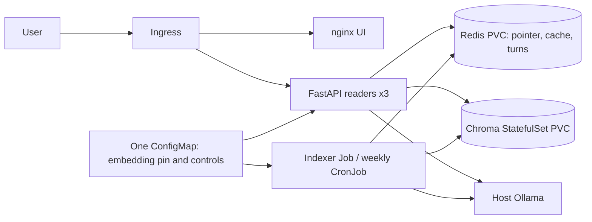

# RAHBAR architecture

RAHBAR answers public university-policy questions from an indexed corpus. A
successful response identifies actual retrieved source/section/page triples;
unsupported questions and unavailable dependencies produce a safe decline.

## One writer, independent readers

Only the indexer writes Chroma. It extracts/OCRs PDFs, cleans page furniture,
chunks sections with overlap, embeds each chunk, verifies a complete snapshot,
and atomically publishes its name in Redis. The API only reads collections and
does not import the indexer or ingest on startup. Scaling three API pods therefore
does not create three competing writers or repeat OCR on each restart. See
[ADR 0001](docs/adr/0001-indexer-as-job.md).

The indexer writes immutable `rahbar-snapshot-*` collections. Redis key
`rahbar:index:rahbar:active` resolves the logical `rahbar` collection. A single
Redis transaction updates this pointer and increments `rahbar:index_generation`.
There is no rename interval in which the active name disappears. A reader resolves
one snapshot and can finish using it after another snapshot is published. Old
snapshots are retained; monitor PVC use and remove old, inactive snapshots only
in a maintenance window after in-flight queries have drained. Automatic GC and
multi-node failover are outside this assignment's implementation.

Before publication, a failed build is discarded and the old pointer is unchanged.
If the transaction succeeds but its acknowledgement is lost, the Job fails
visibly and keeps the potentially published snapshot. A retry can safely publish
another complete snapshot. Redis and Chroma both have persistent volumes, so
ordinary pod replacement preserves the pointer and data. Loss of either volume
requires restoring/rebuilding the index; PVCs are not backups.

## Why Chroma is a StatefulSet

`k8s/base/chroma.yaml` uses one StatefulSet replica with a `volumeClaimTemplates`
claim. The stable `chroma-0` identity and its own `chroma-data-chroma-0` claim keep
the database associated with the same persistent volume across pod replacement.
The `chroma` Service gives readers a stable endpoint. A stateless Deployment
without a PVC would destroy the index on replacement and could produce competing
database processes during rolling updates. A StatefulSet by itself does not make
this one-replica Chroma database highly available.

Redis is a one-replica Deployment with a separately declared PVC and `Recreate`
strategy. AOF persists cache generations, the active snapshot pointer and bounded
turn records. Redis availability is part of API readiness; cache lookup/storage
errors are logged and request handling declines or answers without cache where
possible. Indexer-to-Redis access is intentional: it publishes the pointer and
invalidates cached answers, extending the handout's simpler API-only Redis path.

## Query, grounding and conversations

1. Pydantic strips whitespace and validates a 3–500 character question. The UI
   supplies an opaque per-tab `session_id`; older clients may omit it.
2. An unresolved follow-up bypasses semantic cache. When a session has a previous
   complete question, the reader embeds the contextualized question. Otherwise
   the service asks for a complete question rather than guessing.
3. Standalone queries use pinned query embeddings and a cosine semantic cache.
   Cache keys include index generation and a hash of generation/retrieval settings.
4. Retrieval resolves the active immutable collection, verifies its embedding
   model, filters superseded material normally, and returns configurable top-k
   substantive passages. Explicit years and historical phrases permit old editions.
5. Ollama receives the Pydantic JSON schema, delimited untrusted evidence and low
   temperature. Invalid JSON, citations or provider output are retried once.
6. After validating citation membership, the server renders the complete selected
   policy chunk verbatim, with `[source / section]` after every factual sentence
   and table row. This deliberately favors complete policy evidence over an
   unverified short paraphrase. No golden answers are hard-coded in the application.
7. Valid grounded standalone answers may be cached. Abstentions, unresolved or
   contextual follow-ups, and fallbacks are never cached. Expiring turn records
   retain question/response but never internal model reasoning.

The evidence-rendering choice is documented in [ADR 0005](docs/adr/0005-grounded-evidence-and-turns.md).
It guarantees provenance of displayed text, not correctness of OCR or relevance
of the model's evidence selection. Those remain evaluation responsibilities.

## Pin, probes and delivery

API and indexer read one ConfigMap `EMBED_MODEL`. Chroma collection metadata records
that model and vector dimension. API startup logs an explicit mismatch; readiness
checks Chroma, a nonempty active collection, the pin and Redis. `/healthz` only
checks that the API process responds, preventing dependency-driven restart storms.
Ingress routes `/api`, `/healthz`, `/readyz`, and `/metrics` to API; `/` serves UI.

API rolling updates use surge 1, unavailable 0, a five-second preStop drain and a
35-second termination grace. HPA scales API replicas 3–8 against CPU requests.
This does not scale host Ollama or directly measure its generation queue.
Every base/fixture container has resource requests/limits, a dedicated workload
account, disabled token mounting, explicit non-root identity, dropped capabilities,
no privilege escalation and readonly root filesystem. Data and OCR temporary
paths remain writable on bounded volumes.

Calico enforces default-deny policies. The real deployment script resolves a single
Ollama host IPv4 `/32`; DNS is allowed only to kube-system DNS. The UI has no egress
allowance and cannot query Chroma. Hosted-provider egress is not enabled by default;
it requires a separately reviewed destination policy and a Kubernetes Secret.

CI runs offline tests, type/lint checks, strict manifests, image builds/scans and
an actual Kind fixture stack. CD tests before SHA-tagged publishing and deploys
those exact images to a fresh cluster with an Ingress smoke. The separate real
audit workflow measures OCR, all three chunk settings, real model outputs, token
amplification and cache thresholds; its artifacts must be reviewed before replacing
the committed shipped baseline. See [submission status](docs/SUBMISSION.md) for the
distinction between historical evidence and this branch's fresh measurements.
