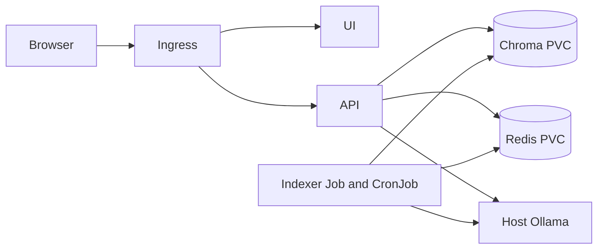

# RAHBAR: grounded policy answers on Kubernetes


RAHBAR answers questions about university policy documents with retrieved evidence and citations. The API refuses unsupported answers, validates model JSON, checks citations against retrieved passages, and exposes health and Prometheus endpoints. The indexer runs as a separate Kubernetes Job. The dev overlay uses a three chunk dummy index and stub model to prove the deployment before the real corpus is integrated.

## Team and status

This is a two person assignment. The platform/API branch implements the API, images, Kubernetes platform, and CI/CD scaffolding. The indexer/evaluation branch is assigned to the teammate; see [docs/TEAMMATE-CODEX-PROMPT.md](docs/TEAMMATE-CODEX-PROMPT.md). The real corpus, OCR pipeline, golden questions, measured evaluation, and end to end RAG demonstration are pending that branch. Do not present the dummy index as final evidence.

## Requirements

Use WSL Ubuntu with Python 3.12, Docker Desktop, kubectl, Minikube, and make. The host Ollama service needs `llama3.2:3b` and `nomic-embed-text`, listening on `0.0.0.0:11434`. Keep tool data and repository on D: on machines with a small C: drive. No `.env` or `.env.example` belongs in Git.

## Local checks

```bash
make test
make lint
make check
make dev
```

`make dev` serves the UI and stub API at <http://localhost:8000>. `make check` reports the remaining teammate work until integration. The API reads only environment variables. For local cluster startup, use the dummy overlay:

```bash
make cluster
make images
kubectl apply -k k8s/overlays/dev
kubectl wait -n rahbar --for=condition=complete job/initial-index --timeout=300s
kubectl rollout status -n rahbar deployment/api --timeout=300s
kubectl get pods,svc,ingress,hpa -n rahbar
kubectl top pods -n rahbar
```

The exact clean-clone apply order is: start Minikube and enable ingress/metrics (`make cluster`), build and load images (`make images`), apply namespace/data services/Job/API/UI (`make apply`), wait for `job/initial-index`, then wait for `deployment/api`. The dev Job writes the dummy index, so readiness only becomes true after it finishes. For Windows with the Docker driver, run `minikube tunnel` in another WSL terminal, then `make ask INGRESS_IP=127.0.0.1 Q="What is the attendance rule?"`. If the ingress address is unavailable, use `kubectl port-forward -n rahbar svc/api 8000:8000` and POST directly to `http://localhost:8000/api/ask`.

The production overlay switches to Chroma retrieval and Ollama. Apply it only after the teammate's indexer image contains the corpus and the real Job has completed. The same `EMBED_MODEL` must configure indexer and API. Reindexing must increment Redis key `rahbar:index_generation` only after successful Chroma writes, which expires old cache entries logically.

## API contract

`POST /api/ask` takes `{"question":"..."}` with 3 to 500 characters. The response has `answer`, `citations`, `answered_from_context`, `confidence`, `retrieved`, `provider`, `cached`, and `request_id`. A citation must name a returned source, section, and page.

| Method | Endpoint | Purpose | Failure behavior |
| --- | --- | --- | --- |
| POST | `/api/ask` | Grounded answer with retrieved references | 422 for invalid question; fallback on invalid model output |
| GET | `/healthz` | Process liveness | No dependency checks |
| GET | `/readyz` | Chroma count and pin plus Redis readiness | 503 if any check fails |
| GET | `/metrics` | Prometheus metrics | Request, latency, cache, abstention, tokens |

## Architecture



Kubernetes uses namespace `rahbar`, ClusterIP data services, restricted service accounts, network policies, resource limits, three API replicas, zero unavailable rolling updates, and HPA 3 to 8. The dev overlay uses `dummy-768`, stub retrieval, and stub generation; the production overlay uses `nomic-embed-text` and `llama3.2:3b`.

## CI/CD and repository flow

CI on pull requests and `dev` runs lint, tests with API coverage, Kubernetes schema checks, image builds, and Trivy. CD on `main` tests again, pushes three immutable `sha-<commit>` tags to Docker Hub using `DOCKERHUB_USERNAME` and `DOCKERHUB_TOKEN` GitHub secrets, and deploys those exact images to an ephemeral Kind cluster for an Ingress smoke test. The fixture evaluation gate still requires integration with the teammate's real pipeline. Do not merge to `main` until that gate and the checker pass. The repository owner must enable branch protection on `main` and capture a blocked merge plus green checks as assignment evidence; a WRITE collaborator cannot set that rule.

Work on feature branches, commit small logical units, push the branch, open a PR into `dev`, then integrate into `main` after the two-person review. Never commit `.env*`, API keys, kubeconfig, or `corpus/raw/`.
