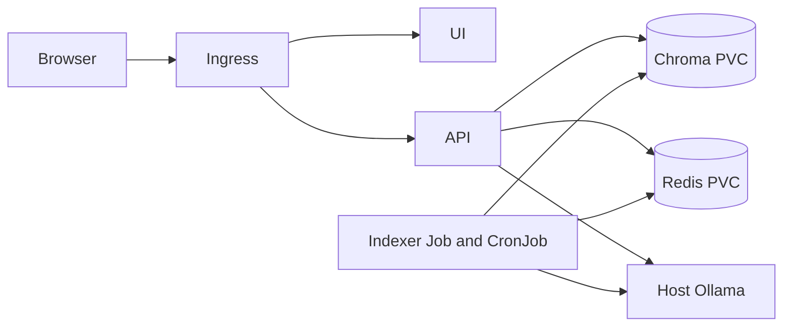

# RAHBAR: grounded policy answers on Kubernetes


RAHBAR answers questions about university policy documents with retrieved evidence and citations. The API refuses unsupported answers, validates model JSON, checks citations against retrieved passages, and exposes health and Prometheus endpoints. The indexer runs as a separate Kubernetes Job. The dev overlay uses a three chunk dummy index and stub model for repeatable CI and deployment checks; the production overlay uses the real corpus and models.

## Team and status

This is a two person assignment. The six verified FAST-NUCES publications, OCR indexer, 15 real golden questions, and deterministic fixture gates are implemented. The live Ollama comparison selected 400/50 chunks and recorded 100% recall@5, 100% citation-reference validity, and 2/2 correct abstentions. Manual review found incomplete answers for q06, q08, q11, and q15 despite the passing gate. See [the measurements and answer-quality limits](docs/PIPELINE.md), [local deployment evidence](docs/evidence/real-corpus-integration-2026-11-06.md), and [the embedding-model mismatch demo](docs/evidence/embedding-model-mismatch-2026-11-06.md).

Release commit [`0659405`](https://github.com/TahaSohail-Goat/SCD_Assignment_2/commit/0659405bf26675e4e8a8624796ef92bdd6dec5d5) was merged through the approved [dev to main PR #6](https://github.com/TahaSohail-Goat/SCD_Assignment_2/pull/6). [CD attempt 2](https://github.com/TahaSohail-Goat/SCD_Assignment_2/actions/runs/42266387143/attempts/2) passed tests, pushed SHA-tagged API/indexer/UI images, and passed the Kubernetes Ingress smoke test. The real [evaluation results](eval/results.json) and [baseline](eval/baseline.json) are committed. The team turned in one Google Classroom entry with the seven required links on November 6, 2026; the submission confirmation was shown in Classroom.

## Requirements

For cluster integration, use Bash with Python 3.12, Docker, kubectl, Minikube, and make. The host Ollama service needs `llama3.2:3b` and `nomic-embed-text`, listening on `0.0.0.0:11434`. Keep tool data and repository on D: on machines with a small C: drive. No `.env` or `.env.example` belongs in Git.

## Local checks

Windows PowerShell can run the indexer and evaluator tests with Git and Python 3.12. Install Python if needed with `winget install --id Python.Python.3.12 -e --scope user`.

```powershell
py -3.12 -m venv .venv
.\.venv\Scripts\python.exe -m pip install -r indexer/requirements-dev.txt -r api/requirements-dev.txt
.\.venv\Scripts\python.exe -m pytest -q -c indexer/pyproject.toml indexer/tests
.\.venv\Scripts\python.exe -m pytest -q -c eval/pyproject.toml eval/tests
.\.venv\Scripts\python.exe -m ruff check api indexer eval corpus
.\.venv\Scripts\python.exe scripts/check_submission.py
```

Use [the corpus guide](docs/CORPUS.md) to download and verify PDFs. The fixtures use local Markdown and mocked services. For the Bash workflow:

```bash
make test
make lint
make check
make dev
```

`make dev` serves the UI and stub API at <http://localhost:8000>. `make check` reports remaining submission artifacts and platform evidence. The API reads only environment variables. For local cluster startup, use the dummy overlay:

```bash
make cluster
make images
kubectl apply -k k8s/overlays/dev
kubectl wait -n rahbar --for=condition=complete job/initial-index --timeout=300s
kubectl rollout status -n rahbar deployment/api --timeout=300s
kubectl get pods,svc,ingress,hpa -n rahbar
kubectl top pods -n rahbar
```

The exact clean-clone apply order is: start Minikube and enable ingress/metrics (`make cluster`), build and load images (`make images`), apply namespace/data services/Job/API/UI (`make apply`), wait for `job/initial-index`, then wait for `deployment/api`. The dev Job writes the dummy index, so readiness only becomes true after it finishes. For Windows with the Docker driver, run `minikube tunnel` in another WSL terminal, then `make ask INGRESS_IP=127.0.0.1 Q="What is the attendance rule?"`. If the ingress address is unavailable, use `kubectl port-forward -n rahbar svc/api 8000:8000` and POST directly to `http://localhost:8000/api/ask`.

The production overlay switches to Chroma retrieval and Ollama. Build and load the private corpus image before applying it, then wait for the initial Job and the API rollout. The same `EMBED_MODEL` must configure indexer and API. Reindexing must increment Redis key `rahbar:index_generation` only after successful Chroma writes, which expires old cache entries logically.

## API contract

`POST /api/ask` takes `{"question":"..."}` with 3 to 500 characters. The response has `answer`, `citations`, `answered_from_context`, `confidence`, `retrieved`, `provider`, `cached`, and `request_id`. A citation must name a returned source, section, and page.

| Method | Endpoint | Purpose | Failure behavior |
| --- | --- | --- | --- |
| POST | `/api/ask` | Grounded answer with retrieved references | 422 for invalid question; fallback on invalid model output |
| GET | `/healthz` | Process liveness | No dependency checks |
| GET | `/readyz` | Chroma count and pin plus Redis readiness | 503 if any check fails |
| GET | `/metrics` | Prometheus metrics | Request, latency, cache, abstention, tokens |

## Architecture



Kubernetes uses namespace `rahbar`, ClusterIP data services, restricted service accounts, network policies, resource limits, three API replicas, zero unavailable rolling updates, and HPA 3 to 8. The dev overlay uses `dummy-768`, stub retrieval, and stub generation; the production overlay uses `nomic-embed-text` and `llama3.2:3b`.

## CI/CD and repository flow

CI on pull requests and `dev` runs lint, tests with API coverage, Kubernetes schema checks, image builds, and Trivy. CD on `main` tests again, pushes three immutable `sha-<commit>` tags to Docker Hub using `DOCKERHUB_USERNAME` and `DOCKERHUB_TOKEN` GitHub secrets, and deploys those exact images to an ephemeral Kind cluster for an Ingress smoke test. The fixture gate runs both offline and on Kind with deterministic model doubles. The real-corpus results and baseline are in `eval/`. `main` is protected and requires PR approval and passing checks. The failing-evaluation and green-check screenshots are in [evaluation-gate evidence](docs/evidence/eval-gate.md); the release CD run and image tags are linked above.

Work on feature branches, commit small logical units, push the branch, open a PR into `dev`, then integrate into `main` after the two-person review. Never commit `.env*`, API keys, kubeconfig, or `corpus/raw/`.
